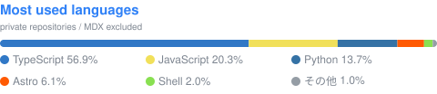

  <!-- Typing SVG by DenverCoder1 - https://github.com/DenverCoder1/readme-typing-svg -->
  

  
  

  

<table><tr><td valign="top" width="50%">

### 📝 ブログの新着
<!-- blog:start -->
[Gitのコミットは差分ではなくスナップショット｜中身を覗いて仕組みを理解](https://rarzyu.com/blog/it-programming/solo-development/git-commit-snapshot/) - 2026-11-16

[【入門】依存性注入（DI）とは？「外から渡す」だけの設計をコードで解説](https://rarzyu.com/blog/it-programming/solo-development/dependency-injection/) - 2026-11-09

[SSG・SSR・CSRの違いとは？HTMLをいつ・どこで作るかで整理](https://rarzyu.com/blog/it-programming/solo-development/ssg-ssr-csr-difference/) - 2026-11-02

[【Astro】コードのシンタックスハイライト設定｜Shikiのテーマと行の強調](https://rarzyu.com/blog/it-programming/solo-development/astro-syntax-highlighting/) - 2026-10-26

[【Astro】OGPの設定方法｜og:imageでSNSのカード表示を整える](https://rarzyu.com/blog/it-programming/solo-development/astro-ogp/) - 2026-10-19
<!-- blog:end -->
もっと読む → [rarzyu.com](https://rarzyu.com)
</td><td valign="top" width="50%">

### 📱 アプリの最新版（App Store）
<!-- apps:start -->
[**Trecord**](https://apps.apple.com/app/id6754829217) 1.5.0 - 2026-10-24

[**pomo**](https://apps.apple.com/app/id6502401630) 2.2.0 - 2026-08-21

[**nomow**](https://apps.apple.com/app/id6474133320) 2.1.0 - 2026-10-14
<!-- apps:end -->
</td></tr></table>

## 📱 Products

### Projects（個人開発）

実装の意図・技術選定・設計判断などをまとめた個別READMEを `projects/` 配下に用意しています（アプリ本体のリポジトリはprivate管理のため）。

#### Trecord

日々のトレーニングと体重を記録、グラフで成長を可視化、SNSシェア用画像も自動生成する筋トレ記録アプリ。

- **技術スタック**: 
    - React Native / Hono(Lambda) / RDS(PostgreSQL) / Cognito / CDK / Astro（AWS から Supabase へ段階的に移行中）
- **リンク**: 
    - [📄 詳細](projects/Trecord.md)
    - [App Store](https://apps.apple.com/app/id6754829217)
    - [Google Play](https://play.google.com/store/apps/details?id=com.rarzyu.trecord) 
    - [Webサイト](https://trecord.rarzyu.com/ja/)

#### pomo

勉強・仕事に集中するためのポモドーロタイマーアプリ。8言語対応・ダークモード。

- **技術スタック**: 
    - React Native / Expo / Astro
- **リンク**: 
    - [📄 詳細](projects/pomo.md) 
    - [App Store](https://apps.apple.com/app/id6502401630) 
    - [Google Play](https://play.google.com/store/apps/details?id=com.rarzyu.pomodoro_timer)
    - [Webサイト](https://pomo.rarzyu.com/ja/)

#### nomow

サプリ・薬の服用管理ToDoアプリ。Flutter製の旧アプリをReact Nativeで完全リプレイス。

- **技術スタック**: 
    - React Native / Expo / Astro
- **リンク**:
    - [📄 詳細](projects/nomow.md)
    - [App Store](https://apps.apple.com/app/id6474133320)
    - [Google Play](https://play.google.com/store/apps/details?id=com.rarzyu.supplement_to_do)
    - [Webサイト](https://nomow.rarzyu.com/ja/)

→ ストアで公開中のアプリは [rarzyu.com/projects/](https://rarzyu.com/projects/) でも紹介しています。

#### 資産管理アプリ（開発中）

Excelで運用していた家計・資産管理を Webアプリとして作り直しています（まずは支出の管理から）。

- **技術スタック**:
    - Next.js / Supabase / Cloudflare Workers / PWA
- **リンク**:
    - [📄 詳細](projects/asset-management-app.md)

### Blog

技術記事や個人開発のノウハウを発信しています。

- プログラミングチュートリアル
- 個人開発のノウハウ
- FIRE戦略・資産形成
- ガジェット・デスク環境のレビュー

## 🧭 全体を通して意識していること

個人開発・業務問わず、以下を軸にして意思決定しています。

- **「やったこと」より「なぜそうしたか」を残す**：技術選定・設計判断には必ず比較検討した代替案を添えて記録する
- **業務で使う技術を、業務に持ち込めるレベルで運用しきる**：個人開発を「お試し」にせず、ストア公開・本番運用・ユーザー対応まで通す
- **保守性・安全性・運用性のバランスを最後まで自分で握る**：個人開発はインフラ・コスト・セキュリティの判断を1人で完結できるのが価値だと考えている
- **型安全性で守る設計**：TypeScript + 共有パッケージで型を流通させ、変更時の追従漏れをコンパイル時に検出する
- **既存仕様 / 既存コードを読み解いて段階的に改善する**：業務で培ったアプローチを、自分のプロダクトにも同じ温度感で適用

## 🛠 Language, Skills

| |メインで使っている|使った経験がある|
|--|--|--|
|**language**|||
|**framework, library**|||
|**infrastructure, DB**|| |
|**tool**|||

業務と個人開発の両方を含みます。モバイルは React Native（Expo）、API は Hono を使っています（アイコンが無いため文字で記載）。

## 📊 GitHub Activity

  <picture>
    <source media="(prefers-color-scheme: dark)" srcset="https://raw.githubusercontent.com/rarzyu/rarzyu/output/github-snake-dark.svg" />
    <source media="(prefers-color-scheme: light)" srcset="https://raw.githubusercontent.com/rarzyu/rarzyu/output/github-snake.svg" />
    
  </picture>

  

  

  

